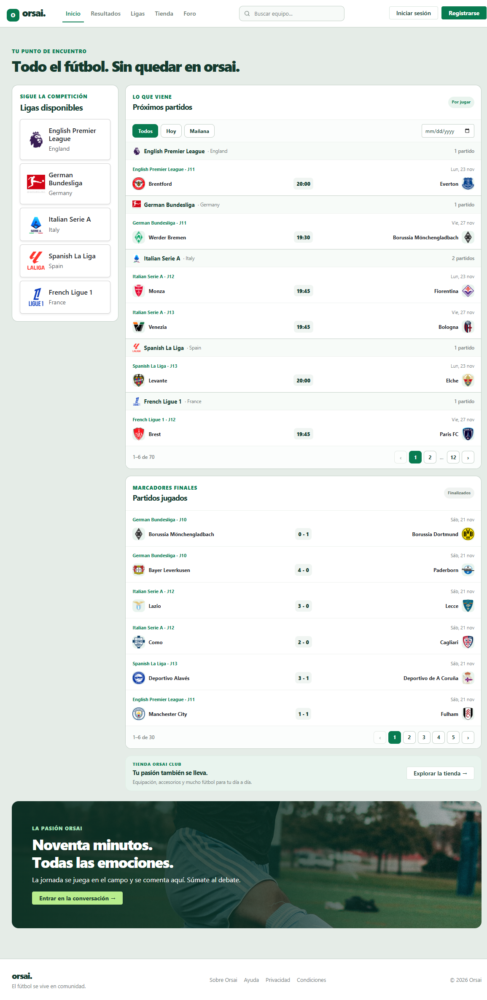
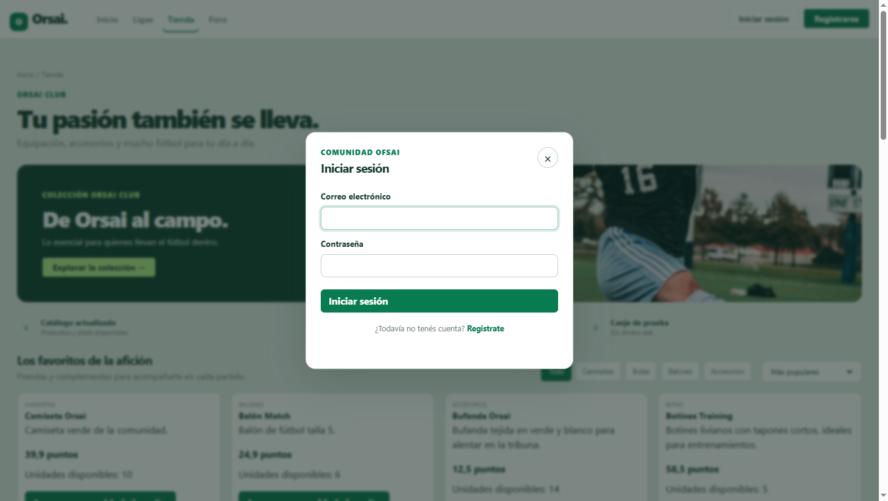
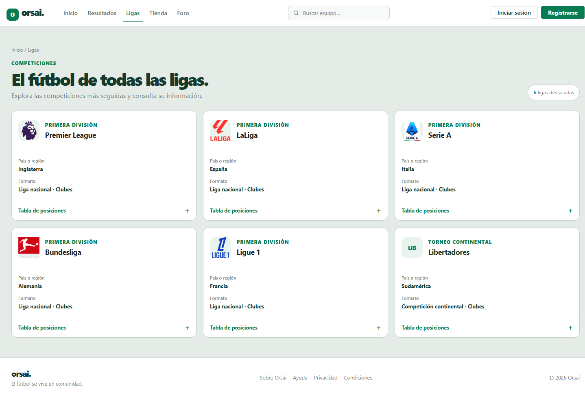
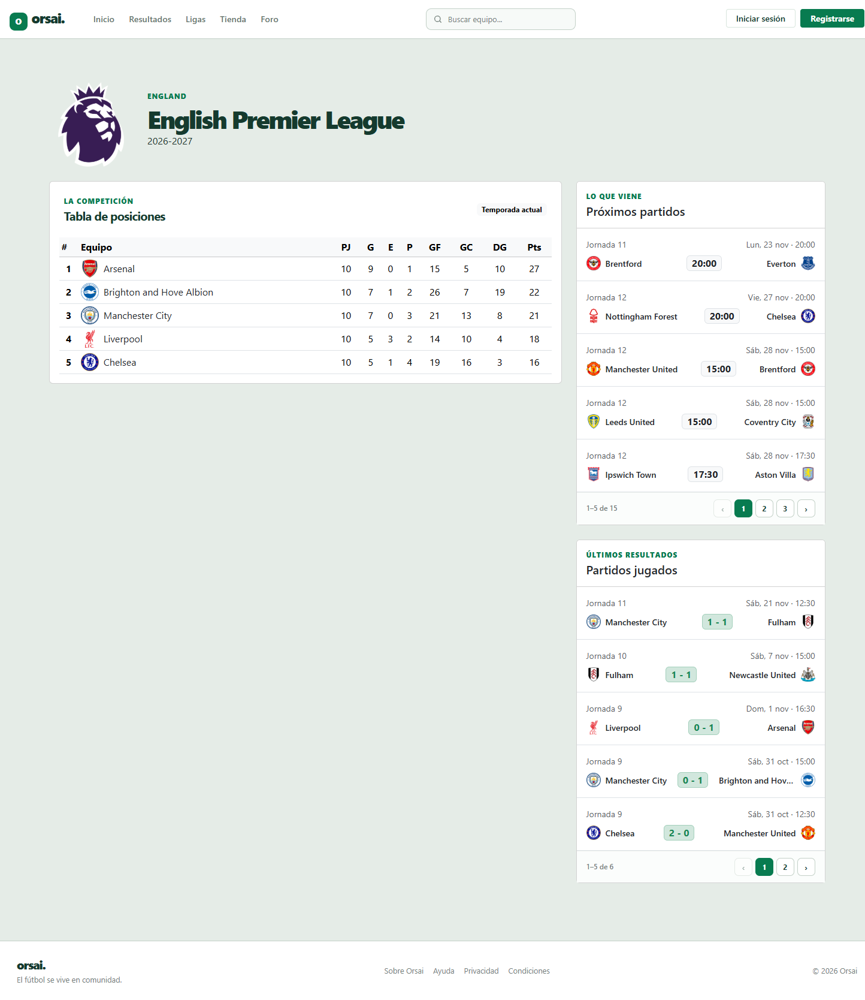
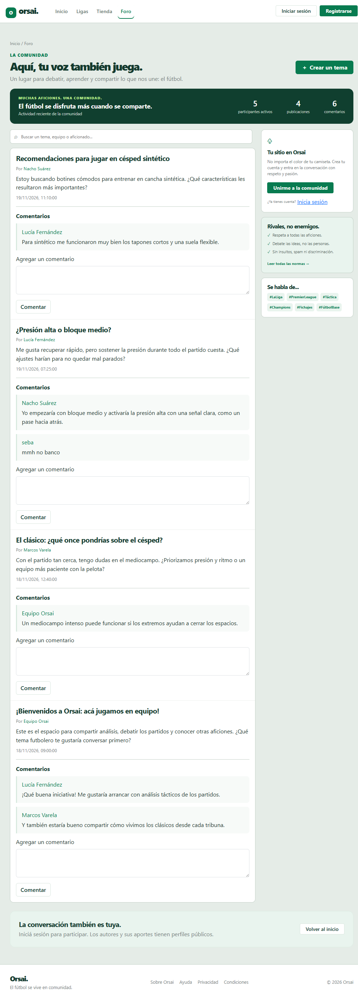
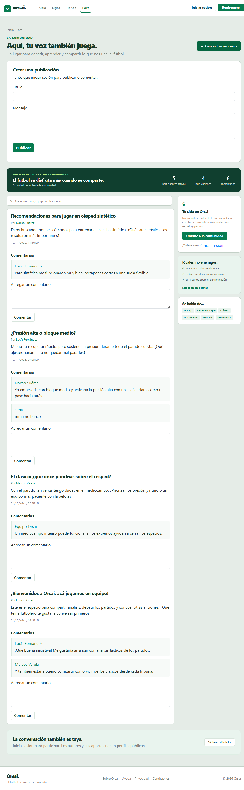
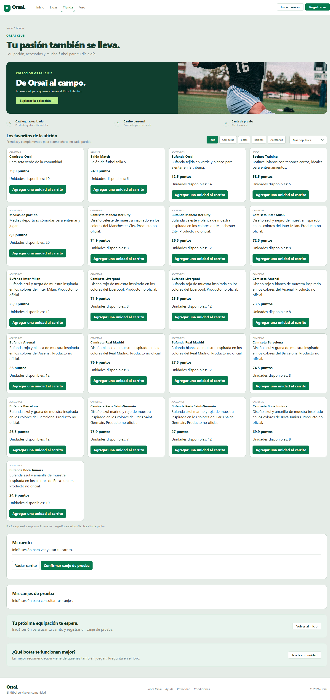
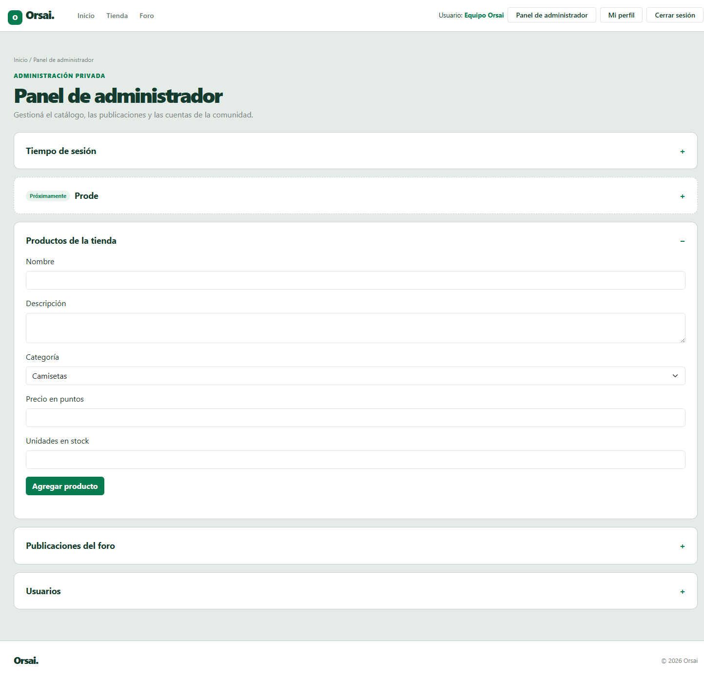
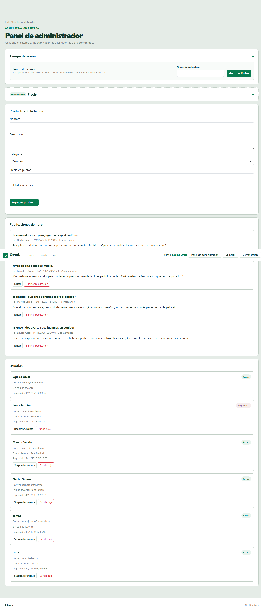

# Guía de usuario de Orsai

Esta guía explica cómo usar la página **Orsai** desde el punto de vista de un **usuario común** y de un **administrador**. Incluye las principales pantallas y funcionalidades, con capturas de ejemplo tomadas sobre la aplicación en ejecución.

## 1. Acceso a la aplicación

- **Dirección local:** [http://localhost:3000](http://localhost:3000)
- La aplicación se ejecuta con Node.js/Express y sirve el frontend desde la misma URL.
- Si necesitás iniciar el servidor en tu equipo (cuando no esté corriendo), desde la raíz del proyecto se puede ejecutar:
  - `npm install` (solo si faltan dependencias)
  - `npm start`

Al abrir la página vas a ver la pantalla de inicio con la navegación principal, las ligas disponibles, los próximos partidos y los partidos jugados.

## 2. Cuentas de demostración

Para probar la aplicación podés usar estas cuentas de ejemplo (según los datos demo del proyecto):

| Rol | Correo | Contraseña | Observaciones |
| --- | --- | --- | --- |
| Administrador | `admin@orsai.demo` | `OrsaiExpo2026!` | Acceso al panel de administración |
| Usuario | `lucia@orsai.demo` | `OrsaiExpo2026!` | Usuario demo |
| Usuario | `marcos@orsai.demo` | `OrsaiExpo2026!` | Usuario demo |
| Usuario | `nacho@orsai.demo` | `OrsaiExpo2026!` | Usuario demo |

> Nota: el estado real de las cuentas puede variar según los datos actuales del entorno (por ejemplo, alguna cuenta puede aparecer suspendida).

## 3. Navegación general

En la barra superior encontrarás:

- **Enlaces principales:** Inicio, Ligas (y/o Resultados según la página), Tienda y Foro.
- **Buscador de equipos:** permite buscar equipos y acceder a su ficha.
- **Acciones de cuenta:** botones **Iniciar sesión** y **Registrarse** cuando no hay sesión iniciada.
- **Con sesión iniciada:** se muestra el usuario y accesos como **Mi perfil**, **Cerrar sesión** y, si corresponde, **Panel de administrador**.
- **Ruta de navegación (migas de pan):** en varias páginas indica dónde estás (por ejemplo, Inicio / Tienda).

---

## 4. Guía para usuario común

### 4.1 Registro e inicio de sesión

Para participar en el foro, usar el carrito/canjes de la tienda o ver tu perfil personal necesitás una cuenta.

1. Hacé clic en **Iniciar sesión** o **Registrarse** en la barra superior.
2. Se abre un cuadro de diálogo con las opciones de acceso.
3. En **Registro** completá los datos solicitados (nombre, correo, contraseña y, si está disponible, equipo favorito).
4. En **Inicio de sesión** ingresá tu correo y contraseña.

Al iniciar sesión correctamente, la barra superior cambia para mostrar tu usuario y las opciones de perfil/cierre de sesión.

### 4.2 Inicio: ligas, próximos partidos y resultados

Desde la página de inicio podés:

- Ver las **ligas disponibles** y acceder a su información.
- Consultar **próximos partidos**, con filtros como **Todos / Hoy / Mañana** y selección de fecha.
- Consultar **partidos jugados** y navegar entre páginas cuando hay paginación.
- Acceder rápidamente a secciones como la tienda y el foro.

### 4.3 Ligas y detalle de liga/equipo

En la sección **Ligas** se muestran las competiciones disponibles. Desde cada tarjeta podés desplegar información adicional (como la tabla de posiciones) o entrar al detalle de la liga.

En el **detalle de una liga** podés consultar:

- Tabla/clasificación.
- Próximos partidos.
- Partidos jugados (con paginación cuando corresponde).

También podés acceder a la ficha de un **equipo** (desde buscador u otros enlaces), donde se muestra información como escudo, país/fundación, liga, rendimiento, próximos/últimos partidos y calendario/historial según disponibilidad.

### 4.4 Foro de la comunidad

El foro permite compartir opiniones y conversar con otros usuarios.

**Qué podés hacer:**

- Ver la actividad de la comunidad (participantes, publicaciones y comentarios).
- Explorar y **buscar temas** de conversación.
- Leer publicaciones y sus comentarios.
- Acceder al **perfil público** de autores y comentaristas.
- **Crear un tema** y **comentar** (requiere iniciar sesión).

Para crear una publicación, hacé clic en **Crear un tema**: se despliega el formulario con título y mensaje. Si no iniciaste sesión, la página te indicará que debés hacerlo para publicar o comentar.

> Recomendación: participá con respeto, debatí ideas y evitá insultos, spam o discriminación.

### 4.5 Tienda (canje con puntos)

La tienda muestra productos de la comunidad (camisetas, botas, balones y accesorios). Los precios están expresados en **puntos**.

**Funcionalidades principales:**

- **Catálogo:** explorar productos, ver descripción, precio en puntos y unidades disponibles.
- **Filtros y orden:** filtrar por categoría y ordenar productos (por ejemplo, por popularidad o precio).
- **Carrito personal:** agregar productos al carrito (requiere sesión para ver/usar el carrito personal).
- **Confirmar canje de prueba:** el sistema recalcula totales y valida stock al confirmar.
- **Mis canjes de prueba:** consultar el historial de canjes realizados.

> Importante: esta versión funciona como **canje de prueba**. **No hay pagos con dinero real** ni gestión de saldo/obtención de puntos.

### 4.6 Perfil de usuario

Cada usuario puede tener un perfil visible en la comunidad.

- **Perfil público:** muestra información pública del usuario y su actividad visible (por ejemplo, publicaciones y comentarios). No expone datos sensibles como el correo.
- **Perfil propio (con sesión iniciada):** además de la actividad, puede mostrar datos personales asociados a tu cuenta (como el correo) y tus canjes de prueba.

Podés acceder a tu perfil desde el enlace **Mi perfil** en la barra superior (cuando tenés sesión iniciada) o visitar perfiles públicos desde el foro.

### 4.7 Cerrar sesión

Cuando hayas terminado, podés cerrar tu sesión desde el botón **Cerrar sesión** en la barra superior. Esto es recomendable si usás un dispositivo compartido.

---

## 5. Guía para administrador

El usuario con rol de administrador tiene acceso a herramientas de gestión adicionales.

### 5.1 Acceso al panel de administración

1. Iniciá sesión con una cuenta administradora (por ejemplo, `admin@orsai.demo`).
2. En la barra superior aparecerá el enlace **Panel de administrador**.
3. Ingresá a `admin.html` desde ese enlace para abrir el panel privado.

El panel está organizado en secciones desplegables para gestionar distintos aspectos de la comunidad.

### 5.2 Gestión de publicaciones del foro

Desde la sección **Publicaciones del foro** el administrador puede:

- Ver el listado de publicaciones (autor, fecha, cantidad de comentarios y contenido).
- **Editar** publicaciones.
- **Eliminar** publicaciones cuando sea necesario.

Además, la moderación del foro permite eliminar contenido inapropiado (incluidos comentarios) desde las herramientas disponibles para administradores en la interfaz del foro.

### 5.3 Gestión de usuarios

Desde la sección **Usuarios** el administrador puede:

- Consultar la lista de usuarios registrados con su información básica (correo, estado, equipo favorito si lo indicó y fecha de registro).
- **Suspender** o **reactivar** cuentas según corresponda.
- **Dar de baja** una cuenta cuando sea necesario (acción sujeta a confirmación en la interfaz).

Los estados de cuenta pueden incluir, entre otros, **Activa** y **Suspendida**.

### 5.4 Otras secciones visibles en el panel

El panel también muestra otras secciones administrativas:

- **Tiempo de sesión:** sección destinada a configurar la duración de la sesión (en minutos). Los cambios, cuando se aplican, afectan a sesiones nuevas.
- **Prode:** aparece marcada como **Próximamente**; en la versión actual no permite guardar ni realizar predicciones.
- **Productos de la tienda:** sección con formulario/listado para la gestión del catálogo desde el panel.

> Nota: la disponibilidad y el comportamiento efectivo de algunas acciones del panel dependen de la implementación vigente de la interfaz y del backend en el entorno en uso.

---

## 6. Notas y aclaraciones

- **Sin pagos reales:** la tienda opera como canje de prueba con puntos; no se realizan cobros ni envíos reales.
- **Datos y entorno:** la información mostrada (ligas, partidos, publicaciones, usuarios, etc.) depende de los datos y servicios disponibles en el momento de uso.
- **Sesión requerida:** crear/comentar en el foro, usar el carrito y acceder a funciones personales requiere iniciar sesión.
- **Perfiles públicos:** los autores y sus aportes pueden consultarse desde perfiles públicos dentro de la comunidad.

---

*Documento generado como guía de uso para la aplicación Orsai (usuario común y administrador).*